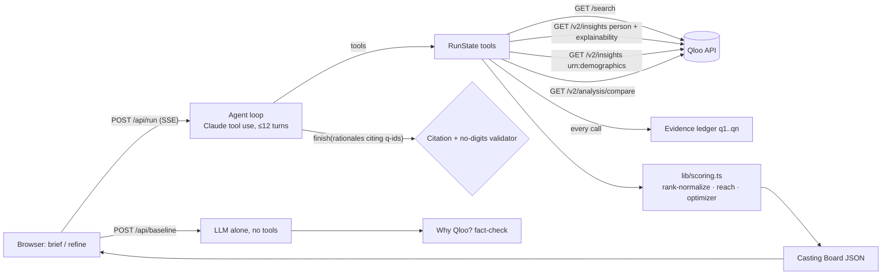

# CastSignal — cast for the audience, not just the headline

**Live demo:** https://castsignal.vercel.app (no login; click **Try the sample project**, ~40–60 s live run)
**Built for:** Qloo Agentic Hackathon 2026 — "Agents, but with taste."
**License:** MIT

CastSignal is an AI casting-audience agent for indie film/TV producers and casting directors. For every role on your shortlist it answers two questions with **live Qloo Taste AI data**:

1. **Fit** — does this person's audience already love projects like ours (your comparable titles)?
2. **Reach** — which audience segments would they add that the comps don't already reach?

It also surfaces **cross-over wildcards** (comedians, musicians, actors not on your list whose fans already overlap with the comps) and proposes the **ensemble with the widest combined reach**, subject to a fit floor and your constraints ("only one A-lister", "keep Florence Pugh", "we need women 35–44").

Studios buy casting analytics; indie teams get agent pitches and popularity rankings. Popularity is not fit. An LLM can only *guess* cross-domain audience overlap and demographic skew; Qloo measures them. The **Why Qloo?** tab runs the same brief through the LLM alone and fact-checks it against Qloo, live.

## How it works



### Agent tools (manual Claude tool-use loop, `lib/agent.ts`)

| Tool | What it does |
|---|---|
| `resolve_entities(names, kind)` | Qloo `/search`; picks an exact-name match that clearly leads on popularity, else marks it *ambiguous* with options |
| `choose_entity` / `ask_user` | The agent settles ambiguity (e.g. "Scream" 1996 vs 2022) or pauses and asks you (UI chooser) |
| `score_fit(role)` | One `/v2/insights` call: person type, `filter.results.entities` = shortlist, signal = comps, explainability on. Reports candidates Qloo can't score |
| `get_demographics()` | Batched `urn:demographics` for comps + candidates + wildcards; returns the comps' baseline and the segments it under-covers |
| `compare_audiences(names)` | `/v2/analysis/compare` candidate vs comps → taste themes the candidate carries that the comps don't |
| `find_wildcards(kind)` | comedians via `urn:tag:genre:person:comedian`; musicians via `urn:entity:artist`; actors via person + `popularity.min` + post-filter on the entity's own tags (Qloo ignores actor tags) |
| `update_brief(...)` | Refine only: change comps, shortlist or target segments |
| `optimize_ensemble(constraints)` | Deterministic TypeScript, no LLM math (below) |
| `finish(summary, rationales)` | Server rejects rationales that cite unknown evidence ids, lack a citation, or contain digits |

State flow: `resolve → (choose | ask_user) → score_fit × roles ∥ demographics → compare → wildcards → optimize → finish`. After the loop the server **rebuilds the board deterministically** from the evidence; any step the LLM skipped runs from cache. If the LLM fails, the board still renders from Qloo evidence with rationales marked unavailable. There is **no silent LLM fallback** for Qloo data.

**Refine** ("Swap Barbarian for Scream") sends the current brief, constraints and the previous ensemble; the agent turns the sentence into `update_brief` / `optimize_ensemble` arguments, Qloo calls are served from the server cache, and the UI shows the diff ("Ensemble changed: Lead: Jenna Ortega → Florence Pugh").

### Scoring math (`lib/scoring.ts`, unit-tested)

- **Fit rank**: affinity rank-normalized within the role's single Qloo call (best = 1, worst = 0, ties averaged). Qloo normalizes affinity per query, so we never compare across calls, and we show bands (Top / Strong / Moderate) not decimals.
- **Baseline**: mean demographic profile of the comps (8 segments: six age bands + women/men, values −1…1 relative to average).
- **Targets**: your chosen segments, or (auto) the segments where the comps under-index.
- **Reach gain** = mean over targets of `max(0, candidate[s] − max(0, baseline[s]))`.
- **Quadrant**: fit rank ≥ 0.5 × reach gain ≥ 0.15 → *Audience expander / Safe bet / Cult pick / Risky*.
- **Ensemble**: brute-force every combination (≤ 6×6×3), score = Σ over targets of the best positive over-index among the picks, tie-break on mean fit; constraints: fit floor (affinity within 10% of the role's best by default), must-include, exclude, A-lister cap (Qloo popularity ≥ 0.95), no person twice. Returns the best and two runners-up.
- **Coverage before/after** = the same Σ for comps alone vs comps + ensemble.

## Qloo endpoints and why

| Endpoint | Why | Example (redacted) |
|---|---|---|
| `GET /search` | Resolve titles (movie + TV) and people; disambiguation | `query=Get Out&types=urn:entity:movie,urn:entity:tv_show&take=4` → Get Out (2017) |
| `GET /v2/insights` (person) | Fit of a shortlist to the comps' audience, with explainability (which comp drove it) | `filter.type=urn:entity:person&signal.interests.entities=<3 comps>&filter.results.entities=<5 people>&feature.explainability=true` → Jenna Ortega top fit, driven by Ready or Not; Daniel Kaluuya absent → "Not enough Qloo data" |
| `GET /v2/insights` (demographics) | Age/gender over-index for comps, candidates, wildcards — one batched call | `filter.type=urn:demographics&signal.interests.entities=<12 ids>` |
| `GET /v2/insights` (tags / artist) | Wildcard discovery | `filter.tags=urn:tag:genre:person:comedian` → Allison Williams, Ali Wong, Aubrey Plaza… |
| `GET /v2/analysis/compare` | Taste themes a candidate brings that the comps don't | `a.signal.interests.entities=<person>&b.signal.interests.entities=<comps>` |

Every call is recorded in a per-run **evidence ledger** (`q1…qn`: endpoint, params summary, status, result count, latency, cached). Every number in the UI traces to a ledger entry or to deterministic code; rationale citations link to it. Identity-attribute tags (ethnicity, gender, nationality…) returned by compare are filtered out; only genre/tone/aesthetic themes are shown.

## Limitations & responsible use

- Affinity describes aggregate audience taste, not facts about any individual; not a box-office prediction or a judgment of talent.
- Qloo coverage varies: e.g. Daniel Kaluuya resolves but has no affinity or demographic data against these comps, and Pete Davidson has fit but no demographics. CastSignal shows these gaps; it never fills them.
- Demographics are relative indices on 8 segments only; no territory data yet.
- Caches are per server instance (1 h TTL); quotas are unpublished.
- The "Why Qloo?" panel is an illustrative live comparison, not a benchmark.

## Setup

```bash
pnpm install
cp .env.example .env.local   # fill ANTHROPIC_API_KEY, QLOO_API_KEY, QLOO_API_BASE
pnpm dev                      # http://localhost:3000
```

Environment variables (server-only; never sent to the browser):

| Var | Purpose |
|---|---|
| `ANTHROPIC_API_KEY` | Claude agent (model `claude-sonnet-5-5`) and the LLM-only baseline |
| `QLOO_API_KEY` | Qloo hackathon API key (sent as `X-Api-Key`) |
| `QLOO_API_BASE` | `https://hackathon.api.qloo.com` |

## Tests

```bash
pnpm test     # vitest: scoring math, optimizer constraints, citation validator, zod parsing of real Qloo responses, client retry/timeout/429/cache
pnpm smoke    # live: resolves the sample, scores fit, demographics, wildcards, compare, optimizer against the real Qloo API
pnpm agent    # live: full agent run from the CLI, prints the event stream; `pnpm agent "We need to reach women 35–44."` tests a refine
pnpm build    # type-check + production build
```

Fixtures in `tests/fixtures/` are trimmed **real** Qloo responses (no keys) and are used only by unit tests; the app never reads them.

## Deploy

Vercel (Next.js 16 App Router). `vercel env add` the three variables for Production, then `vercel deploy --prod`. `/api/run` streams SSE with `maxDuration = 300`. `/api/health` reports configuration and Qloo reachability without exposing keys. API routes validate input with zod, cap request size, and rate-limit per IP so the demo is not an open Qloo proxy.

## Project layout

```
app/api/run       SSE agent run          lib/qloo.ts     typed Qloo client: timeout, retry, LRU cache, zod
app/api/baseline  LLM-only baseline      lib/run.ts      run state, tools, evidence ledger, board builder
app/api/resolve   autocomplete           lib/agent.ts    Claude tool-use loop, prompt, validators
app/api/health    health check           lib/scoring.ts  deterministic math
components/       UI (Board, Trace, WhyQloo, BriefForm, Memo)
scripts/          smoke + agent CLI       tests/          vitest + real-response fixtures
research/         competition analysis, idea scorecard, open-source audit, technical plan
```

## Eligibility checklist

- [x] Public URL works with no login (production alias verified from a clean session)
- [x] Qloo is used live (evidence ledger shows real calls; `/api/health` checks reachability)
- [x] Agentic tool loop is demonstrable (live trace panel; `pnpm agent`)
- [x] Public repo + MIT LICENSE (detected by GitHub)
- [x] README with setup, env and tests
- [x] `.env.example` contains no secrets
- [x] No secrets in the repo or client bundle (`git grep` and `.next/static` grep)
- [x] English description
- [x] Third-party notices (below)
- [ ] Submitted on Devpost before Oct 30, 11:45 PM ET (done by the team)

## Third-party notices

- [Next.js](https://github.com/vercel/next.js), [React](https://github.com/facebook/react), [Tailwind CSS](https://github.com/tailwindlabs/tailwindcss), [zod](https://github.com/colinhacks/zod), [vitest](https://github.com/vitest-dev/vitest), [tsx](https://github.com/privatenumber/tsx) — MIT
- [@anthropic-ai/sdk](https://github.com/anthropics/anthropic-sdk-typescript) — Apache-2.0
- Fonts via Google Fonts: Bebas Neue, Archivo, Courier Prime — SIL Open Font License 1.1
- Data: [Qloo Taste AI](https://qloo.com) hackathon API, used under the hackathon terms; images are served from Qloo's image CDN.

All code in this repository was written during the hackathon submission period.
